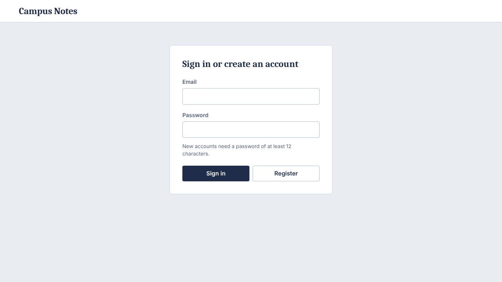
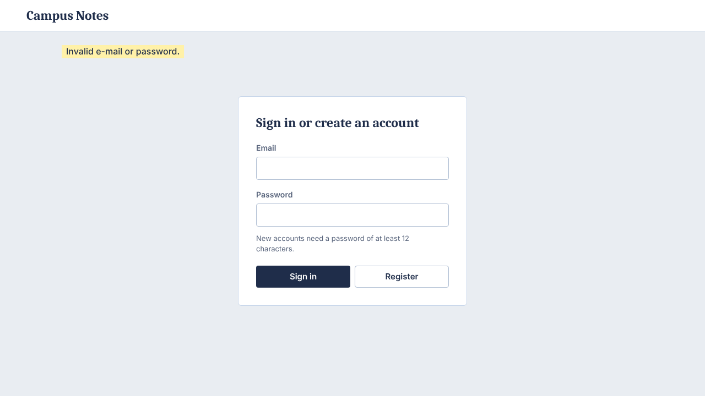
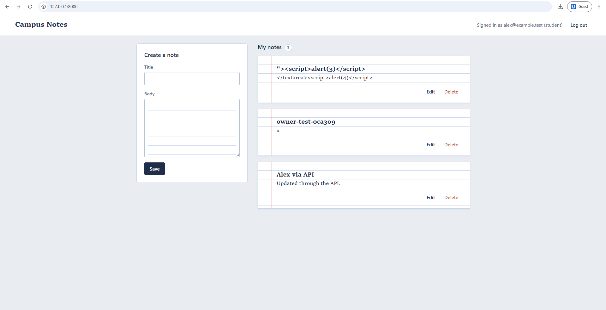
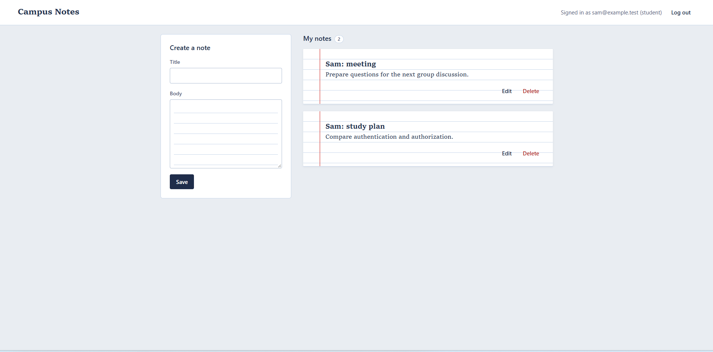
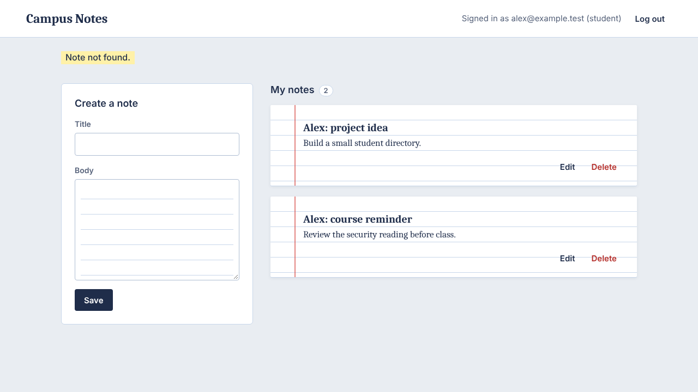
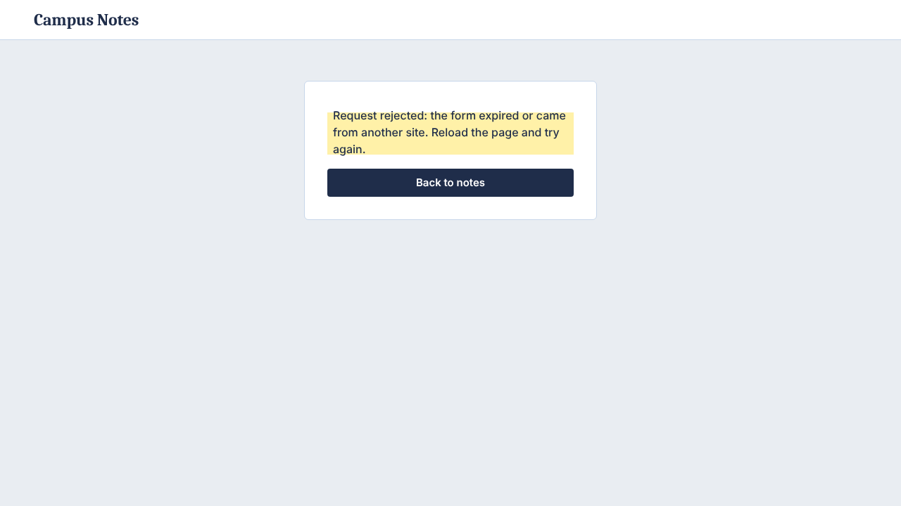
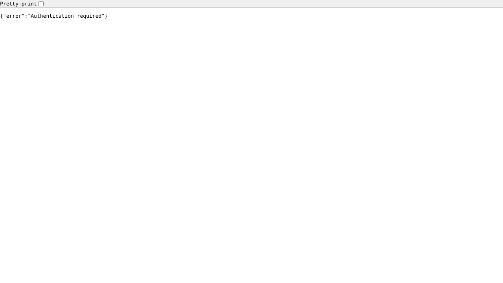
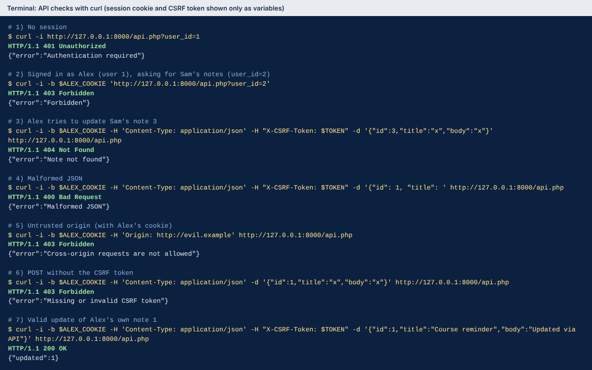
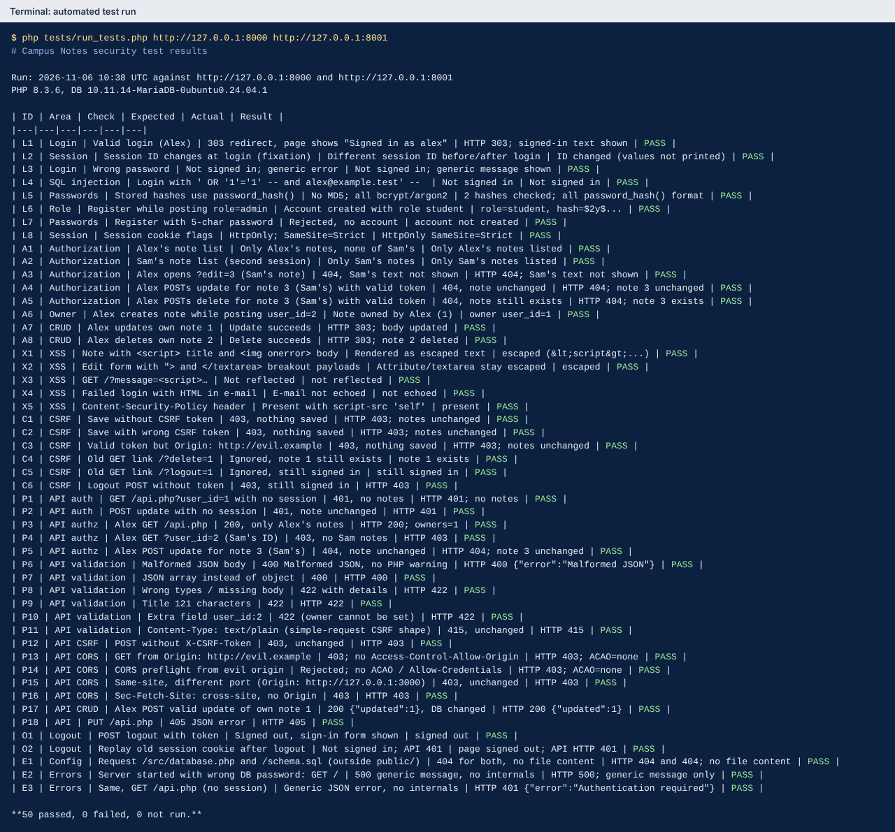

# Repair Campus Notes — Security Code Review

**Repository:** [paste your Git repository URL here]

**Course:** Integrative Programming and Technologies — Laboratory: Security Code Review

All 11 security problems in Campus Notes are fixed. The app works the same way for users, and all 50 automated tests pass.

## 1. Setup and project structure

**Tested on:** Windows with XAMPP: PHP 8.5.12 and MariaDB 10.4.32.

**How to run it**

1. Start MySQL in the XAMPP Control Panel.
2. Import `schema.sql`. It creates the `notes_lab` database with two test accounts.
3. Create a MySQL user `notes_app` that can only read and change data in `notes_lab`.
4. In PowerShell, set `LAB_DB_USER` and `LAB_DB_PASSWORD`, then run `php -S 127.0.0.1:8000 -t public`.
5. Open http://127.0.0.1:8000 in the browser.

The exact commands are in `README.md`.

**Project files**

| File or folder | What it does |
|---|---|
| `public/index.php` | The web page: sign in, notes, log out |
| `public/api.php` | The JSON API for listing and updating notes |
| `public/style.css` | Page design |
| `src/database.php` | Connects to the database using environment variables |
| `src/session.php` | Safe login sessions |
| `src/csrf.php` | Blocks forged requests from other websites |
| `src/users.php` | Register and sign in, with secure password hashing |
| `src/notes.php` | Note queries, always limited to the signed-in user |
| `src/view.php` | Escapes output and sends security headers |
| `src/bootstrap.php` | Hides error details from users and logs them instead |
| `templates/` | The HTML pages |
| `tests/run_tests.php` | Automated security tests |
| `tools/reset_passwords.php` | Re-hashes the two test accounts' passwords |
| `docs/screenshots/` | Screenshots used in this report |

**What changed in the structure:** the starter put everything in one file. Now each job has its own file in `src/`, and only the `public/` folder can be opened from the browser.

**Packages:** none. Only built-in PHP functions are used.

## 2. Findings and fixes

All 11 problems are fixed. Line numbers point to the original starter files.

| # | Problem | OWASP Top 10:2025 | Status |
|---|---|---|---|
| 1 | SQL injection | A05 Injection | Fixed |
| 2 | Weak password storage (MD5) | A04 Cryptographic Failures | Fixed |
| 3 | Users could see and change other users' notes | A01 Broken Access Control | Fixed |
| 4 | Cross-site scripting (XSS) | A05 Injection | Fixed |
| 5 | No CSRF protection; GET links that change data | A01 Broken Access Control | Fixed |
| 6 | Unsafe login and logout sessions | A07 Authentication Failures | Fixed |
| 7 | User could choose their role or a note's owner | A01 Broken Access Control | Fixed |
| 8 | Error details shown; root database account as fallback | A02 Security Misconfiguration | Fixed |
| 9 | API had no login or ownership checks | A01 Broken Access Control | Fixed |
| 10 | API did not check its input | A10 Mishandling of Exceptional Conditions | Fixed |
| 11 | API could be read by any website | A01 Broken Access Control | Fixed |

### 1. SQL injection

- **Where:** `index.php` lines 26–29 (login) and 40–44 (save note).
- **Problem:** user input was pasted straight into SQL. Typing `alex@example.test' -- ` as the email signed in as Alex with any password.
- **Fix:** every query now uses a prepared statement, so input is never run as SQL.
- **Status:** Fixed.

```php
$stmt = $db->prepare('SELECT id, email, password_hash, role FROM users WHERE email = ?');
$stmt->execute([$email]);
```

### 2. Weak password storage

- **Where:** `index.php` lines 17 and 27; `schema.sql` lines 21–22.
- **Problem:** passwords were stored with MD5, which can be cracked in seconds if the database leaks.
- **Fix:** passwords are stored with `password_hash()` and checked with `password_verify()`. New passwords need at least 12 characters.
- **Status:** Fixed.

```php
password_hash($password, PASSWORD_DEFAULT);
```

### 3. Users could see and change other users' notes

- **Where:** `index.php` line 76 (list), 77–81 (edit), 49–57 (update), 59–64 (delete).
- **Problem:** everyone saw every note, and any note could be edited or deleted by changing its ID.
- **Fix:** every note query includes the signed-in user's ID, so another user's note behaves as if it does not exist.
- **Status:** Fixed.

```php
UPDATE notes SET title = ?, body = ? WHERE id = ? AND user_id = ?
```

### 4. Cross-site scripting (XSS)

- **Where:** `index.php` lines 91, 102, 106–108 and 122–125; the message came from the URL (line 72) and from the failed-login text (line 36).
- **Problem:** note text and messages were printed as raw HTML, so a note containing `<script>` would run code in the viewer's browser.
- **Fix:** every value on the page goes through `e()`, which escapes HTML. Messages no longer come from the URL, and a Content-Security-Policy header blocks inline scripts as a backup.
- **Status:** Fixed.

```php
return htmlspecialchars((string) $value, ENT_QUOTES | ENT_SUBSTITUTE | ENT_HTML5, 'UTF-8');
```

### 5. No CSRF protection; GET links that change data

- **Where:** all forms (lines 94–119); delete link `?delete=` (lines 59, 125); logout link `?logout=` (lines 66, 102).
- **Problem:** another website could submit these forms for a signed-in user, and a plain link could delete notes.
- **Fix:** every change is a POST with a secret token tied to the session, and requests from other sites are rejected. Delete and log out are now buttons, not links.
- **Status:** Fixed.

```php
if (!request_origin_is_trusted() || !csrf_is_valid($_POST['csrf_token'] ?? null)) { /* 403 */ }
```

### 6. Unsafe login and logout sessions

- **Where:** `index.php` line 2 (session start), 30–32 (login), 66–70 (logout).
- **Problem:** the session ID stayed the same after login (session fixation), logout did not really end the session, and the cookie had no protective settings.
- **Fix:** a new session ID at login; logout destroys the session; the cookie is HttpOnly and SameSite=Strict, and Secure on HTTPS; sessions end after 30 idle minutes.
- **Status:** Fixed.

```php
session_regenerate_id(true);
```

### 7. User could choose their role or a note's owner

- **Where:** `index.php` lines 18 and 97 (role), 40 and 115 (owner); `api.php` line 17.
- **Problem:** the form let anyone register as admin or save a note under another user's ID.
- **Fix:** new accounts are always "student", and the owner always comes from the session. Those form fields were removed.
- **Status:** Fixed.

```php
create_note($db, $userId, $title, $body); // $userId comes from the session
```

### 8. Error details shown; root database account as fallback

- **Where:** `index.php` lines 3–4 and 8–9; `api.php` lines 3 and 10–11.
- **Problem:** errors were printed on the page with file paths and stack traces, and the app quietly used the `root` account with no password.
- **Fix:** users now see a short generic message and details go to the server log. The app will not start without `LAB_DB_USER` and `LAB_DB_PASSWORD`.
- **Status:** Fixed.

```php
ini_set('display_errors', '0');
```

### 9. API had no login or ownership checks

- **Where:** `api.php` lines 16–22 (read) and 24–30 (update).
- **Problem:** anyone, even signed out, could read any user's notes and change any note.
- **Fix:** the API requires sign-in, returns only your own notes, and only updates notes you own.
- **Status:** Fixed.

```php
if ($userId === null) { json_response(401, ['error' => 'Authentication required']); }
```

### 10. API did not check its input

- **Where:** `api.php` lines 25–27.
- **Problem:** broken JSON caused PHP warnings with server paths, and bad data went straight to the database.
- **Fix:** the API checks the content type, body size, JSON format and each field, and answers with a clear error code (400, 413, 415 or 422).
- **Status:** Fixed.

```php
$data = json_decode($raw, true, 8, JSON_THROW_ON_ERROR);
```

### 11. API could be read by any website

- **Where:** `api.php` lines 5–6.
- **Problem:** the API told browsers that any website could use it with the visitor's login, so a malicious site could read their notes.
- **Fix:** those headers were removed, requests from other origins are rejected, and updates need the CSRF token in an `X-CSRF-Token` header.
- **Status:** Fixed.

```php
if (!request_origin_is_trusted()) { json_response(403, ['error' => 'Cross-origin requests are not allowed']); }
```

## 3. Tests

**How it was tested:** a test script (`tests/run_tests.php`) signs in as Alex and Sam in separate sessions, tries each attack, and checks the database to confirm nothing changed. It runs 50 checks, and all of them passed. The table shows the main ones; the full list is in `tests/results.md`. Every check below was run.

| Check | Steps | Expected | Actual | Result |
|---|---|---|---|---|
| Valid login | Sign in as Alex | Signed in | Signed in | Pass |
| Invalid login | Sign in with a wrong password | Error message, not signed in | Error message, not signed in | Pass |
| SQL injection | Use `' OR '1'='1' -- ` as the email | Not signed in | Not signed in | Pass |
| Password storage | Look at the users table | No MD5 hashes | Only bcrypt hashes | Pass |
| Own notes only | Alex and Sam sign in, in separate sessions | Each sees only their own notes | Each sees only their own notes | Pass |
| Other user's note | Alex opens, updates and deletes Sam's note 3 | "Not found", note unchanged | "Not found", note unchanged | Pass |
| HTML in a note | Save a note containing `<script>` | Shown as plain text | Shown as plain text | Pass |
| Forged request | Save without the CSRF token, or from another site | Rejected (403) | Rejected (403), nothing saved | Pass |
| Old GET links | Open `/?delete=1` and `/?logout=1` | Nothing happens | Nothing happens | Pass |
| Role and owner | Register with role=admin; save with user_id=2 | Role student; owner Alex | Role student; owner Alex | Pass |
| Logout | Log out, then reuse the old session cookie | Signed out; API says 401 | Signed out; API says 401 | Pass |
| API, no login | Call `/api.php` without signing in | 401 | 401 | Pass |
| API, other user's ID | Alex asks for `user_id=2` | 403 | 403 | Pass |
| API, broken JSON | Send malformed JSON | 400 | 400 | Pass |
| API, other website | Send `Origin: http://evil.example` | 403, no CORS headers | 403, no CORS headers | Pass |
| Error details | Start the app with a wrong DB password | Generic error page | Generic error page | Pass |

**Problems found while testing:** the first run failed because the app server still used an old database password. After that, one check failed because PHP 8.5 sends unknown page addresses to `index.php`; the app now answers "not found" for them. A check in a real browser also found that one security header (`Referrer-Policy: no-referrer`) blocked every browser login; it was changed to `same-origin`. The final run passed all 50 checks.

### Screenshots

Figures 3 and 4 were taken on the Windows test machine. The others were captured on a second test machine running the same code. No passwords, session IDs or tokens are shown.

**Figure 1.** The app running at http://127.0.0.1:8000.



**Figure 2.** Wrong password: a short error message and no sign-in.



**Figure 3.** Alex sees only Alex's notes. Notes containing `<script>` show as plain text, and no script runs. The extra notes are left over from the test run.



**Figure 4.** Sam, signed in in a separate browser, sees only Sam's notes.



**Figure 5.** Alex tries to open Sam's note (`/?edit=3`) and gets "Note not found."



**Figure 6.** A form that tries to delete a note without the CSRF token is rejected.



**Figure 7.** After logging out, the API answers "Authentication required".



**Figure 8.** API checks with `curl`: no login (401), another user's ID (403), another user's note (404), broken JSON (400), another website (403), missing token (403), and a valid update of your own note (200).



**Figure 9.** The full automated test run: 50 passed.



### Not tested, and remaining risks

- **HTTPS settings:** the Secure cookie setting only works over HTTPS, and this lab runs on plain HTTP.
- **Too many login attempts:** there is no limit yet, so someone could keep guessing passwords. Suggested fix: slow down or lock an account after several failed attempts.
- **Session timeout:** the 30-minute idle timeout was not tested.
- **Logging:** errors only go to the server console. A real server needs proper logs and alerts.
- **Going live:** a real deployment needs HTTPS, a proper web server instead of `php -S`, and passwords kept in a secret store.
